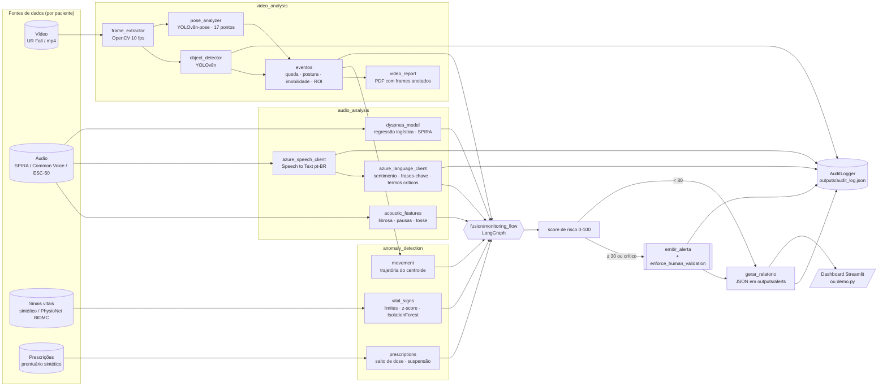
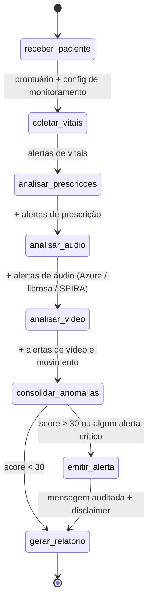

# Diagrama do fluxo multimodal

## Visão geral — das fontes ao alerta



## O grafo LangGraph em detalhe



**Estado compartilhado** (`MonitoringState`, um `TypedDict`): `paciente_id`, `paciente`, `monitoramento`, `vitais_df`, `laudo_audio`, `laudo_video`, `alertas: list[Alerta]`, `score_risco`, `nivel_risco`, `deve_alertar`, `mensagem_alerta`, `relatorio`, `erros`.

**`Alerta`**: `paciente`, `modalidade` (vitais | prescricao | audio | video | movimento), `severidade` (baixa | media | alta | critica), `evidencia`, `timestamp`.

## Score de risco

```
peso(severidade)  = baixa 1 · media 2 · alta 4 · critica 12
bonus             = 1 + 0,25 × (nº de modalidades distintas − 1)
score             = min(100, soma dos pesos × bonus × 5)

nível: 0 normal · 1–29 moderado · 30–59 alto · 60–100 crítico
alerta é emitido se score ≥ 30 OU existe alerta crítico
```

## Guardrails em todo caminho de saída

```mermaid
flowchart LR
    X[texto de alerta / relatório] --> G{enforce_human_validation}
    G -->|detecta "tome", "administre", "prescrevo"...| W[aviso de segurança registrado]
    G --> D[anexa disclaimer de validação humana]
    D --> L[(AuditLogger)]
```
