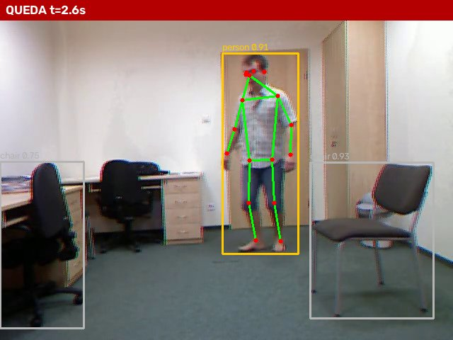
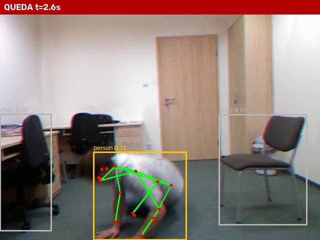
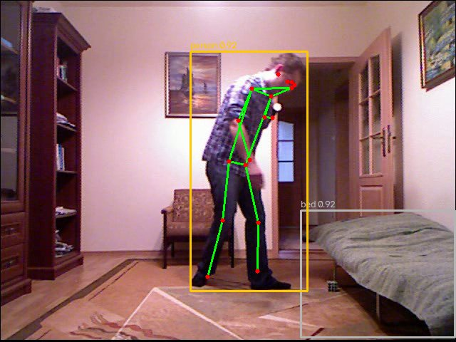
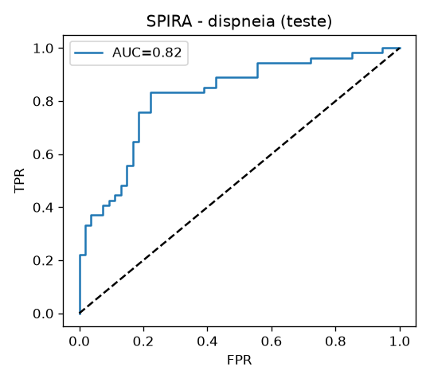
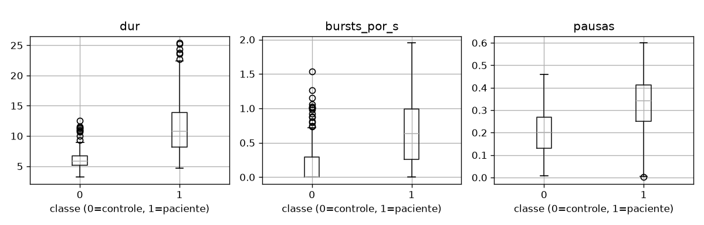
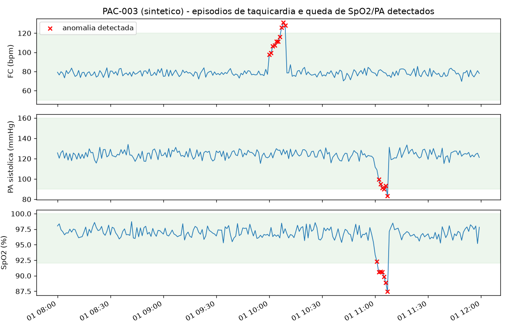
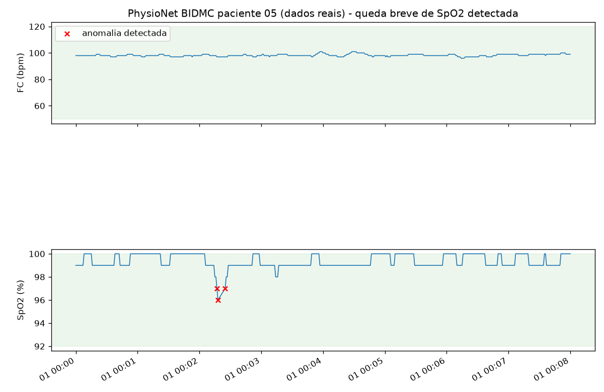
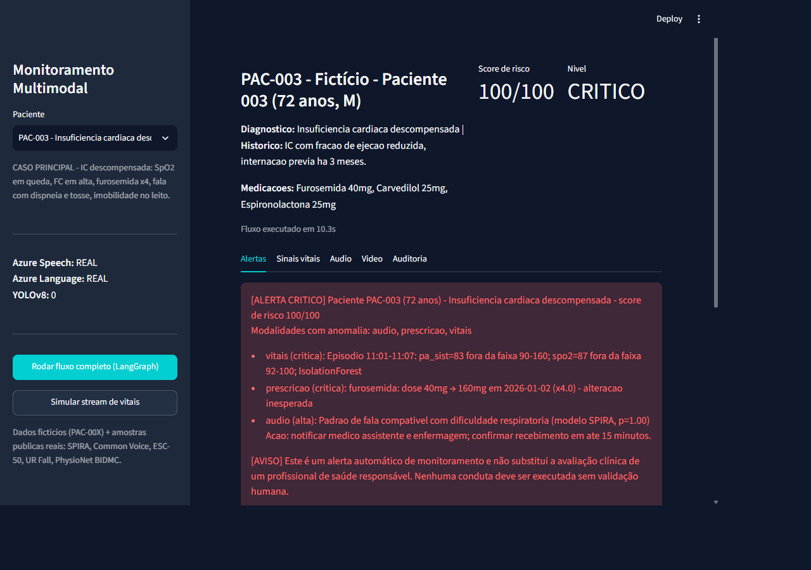

# Relatório Técnico — Monitoramento Multimodal de Pacientes

**Tech Challenge Fase 4 — Pós-graduação IA para Devs (FIAP)**
Guilherme Ferreira de Arruda — RM 373210 — Grupo 88 (projeto individual)
Repositório: https://github.com/GFerreira1902/TechChallenge4GFA

---

## 1. O problema em uma frase

Um hospital quer acompanhar os pacientes de forma contínua, juntando **o que a câmera vê**, **o que o paciente fala** e **o que os aparelhos medem**, para perceber sinais de piora antes que virem emergência — e avisar a equipe automaticamente.

Este projeto é um protótipo funcional desse sistema. Ele não substitui ninguém: todo alerta que gera termina com a frase *"nenhuma conduta deve ser executada sem validação humana"*, e cada decisão fica registrada em um log de auditoria.

---

## 2. Como o sistema funciona (visão geral)

Pense em quatro "sentidos" que trabalham em paralelo e depois se reúnem para tomar uma decisão:

```
   Câmera (vídeo)  ──► Análise de vídeo ──┐
   Microfone (voz) ──► Análise de áudio ──┤
   Monitor (vitais)──► Análise de vitais ─┼──► Fusão ──► Score de risco ──► Alerta à equipe
   Prontuário (Rx) ──► Análise de doses ──┘                                 + Relatório
```

| Sentido | Pergunta que responde | Tecnologia usada |
|---|---|---|
| **Vídeo** | O paciente caiu? Está parado há muito tempo? Entrou em área proibida? | YOLOv8 (detecta pessoas e objetos) + YOLOv8-pose (desenha o "esqueleto" da pessoa) |
| **Áudio** | O que o paciente disse? Está com falta de ar? Mencionou dor, tontura? Está triste ou angustiado? | Azure Speech to Text (transcrição), Azure AI Language (sentimento e termos), librosa + modelo próprio (padrão respiratório da fala) |
| **Vitais** | Frequência cardíaca, pressão ou oxigenação saíram do normal? Mudaram de repente? | Regras clínicas + estatística (z-score) + Isolation Forest (scikit-learn) |
| **Prescrições** | Alguma dose mudou de forma brusca ou um remédio foi suspenso sem registro? | Regras sobre o histórico de medicações |

A **fusão** é um fluxo orquestrado com LangGraph que executa as quatro análises em sequência, soma as evidências em um **score de 0 a 100** e decide se emite alerta. O diagrama completo está em [diagrama_fluxo.md](./diagrama_fluxo.md).

---

## 3. Os dados

Não existe um dataset público que tenha vídeo, voz, vitais e prescrições **do mesmo paciente**. Por isso o projeto monta um "paciente composto": cinco pacientes fictícios (PAC-001 a PAC-005, herdados da Fase 3) recebem, cada um, amostras **reais** de fontes públicas diferentes.

| Modalidade | Fonte | O que é | Por que foi escolhida |
|---|---|---|---|
| Voz de paciente | **SPIRA** (USP / HC-FMUSP) | 432 gravações em português de pessoas reais: 219 pacientes com insuficiência respiratória e 213 pessoas saudáveis, todas lendo a mesma frase | Único dataset público em PT-BR com fala de pacientes com falta de ar — exatamente o sintoma pedido no enunciado |
| Voz saudável | **Mozilla Common Voice 27.0 PT** | 22 clipes de voluntários de 30 a 70+ anos | Referência de voz normal com transcrição conhecida, para medir a precisão do Azure |
| Tosse / respiração | **ESC-50** | 22 clipes de tosse e 22 de respiração | Sons respiratórios reais para calibrar o detector |
| Vídeo | **UR Fall Detection** (Univ. Rzeszów) | 2 vídeos com queda real e 2 com atividades normais (andar, sentar, deitar), câmera fixa | Dataset acadêmico padrão para detecção de quedas |
| Sinais vitais | **PhysioNet BIDMC** + séries sintéticas | 3 pacientes reais de UTI (frequência cardíaca e SpO2 a cada segundo) + séries simuladas com anomalias injetadas | Os dados reais validam o detector; os sintéticos permitem medir acerto exato porque sabemos onde a anomalia foi colocada |
| Prescrições | Sintético | Histórico de doses por paciente fictício | Não há dataset público de prescrições individuais |

Os pacientes fictícios estão em `data/raw/synthetic_patients.json`; as amostras ficam em `data/samples/` (não versionadas, com script de download em `scripts/download_samples.py` e instruções em `data/samples/README.md`).

**Observação sobre o SPIRA:** o README interno do arquivo diz "apenas para revisão, não distribuir" enquanto o repositório oficial declara licença CC BY-SA 4.0. Por cautela, os áudios são usados **apenas localmente** para validação, não são redistribuídos nem exibidos no vídeo além de métricas e transcrições, e a fonte é citada (Casanova et al., ACL 2021).

---

## 4. Cada modalidade em detalhe

### 4.1 Vídeo — "o que a câmera vê"

**Como funciona.** O vídeo é lido quadro a quadro (1 a cada 3 quadros, ou seja, 10 por segundo). Em cada quadro:
1. O **YOLOv8n** marca onde estão pessoa, cama, cadeira e outros objetos.
2. O **YOLOv8n-pose** localiza 17 pontos do corpo (ombros, quadris, joelhos…) e desenha o esqueleto.
3. A partir do esqueleto calculamos a **altura do corpo** e a **inclinação do tronco** (0° = em pé, 90° = deitado).

Com essas duas medidas ao longo do tempo, regras simples detectam:
- **Queda**: altura cai mais de 35% em menos de 1 segundo **e** o tronco fica horizontal.
- **Postura anômala**: tronco inclinado por mais de 3 segundos fora do leito.
- **Imobilidade**: pessoa sem se deslocar por mais de 20 segundos.
- **Área crítica**: pessoa entra em uma região da imagem marcada como proibida (ex.: porta).

**Por que YOLOv8-pose e não OpenPose?** O enunciado cita OpenPose como exemplo. OpenPose é difícil de instalar no Windows e muito pesado para a placa de vídeo disponível (GTX 1650, 4 GB). O YOLOv8-pose faz a mesma coisa (estimar os pontos do corpo), roda em ~40 ms por quadro na GPU e tem instalação de uma linha. É um equivalente funcional.

**Resultado.** Nos 4 vídeos do UR Fall:

| Vídeo | Conteúdo real | O sistema detectou |
|---|---|---|
| fall-01 | pessoa cai | **Queda** aos 2,6 s (altura 285→183 px, tronco 69°) |
| fall-05 | pessoa cai | **Queda** aos 2,4 s |
| adl-01 | pessoa anda e senta | nada (correto) |
| adl-05 | pessoa deita na cama | nada (correto — deitar devagar não é queda) |

4 de 4 corretos. O sistema gera automaticamente um **relatório em PDF** com a linha do tempo dos eventos e os quadros anotados.

| Momento da queda | Pessoa no chão | Atividade normal |
|---|---|---|
|  |  |  |

*Repare que no quadro do chão o esqueleto está incompleto: a pose falha quando a pessoa está deitada. Por isso o sistema usa a caixa da detecção de pessoa como reserva — se a caixa fica mais larga que alta, considera o corpo horizontal.*

### 4.2 Áudio — "o que o paciente fala e como fala"

Três análises acontecem sobre o mesmo áudio:

**a) Transcrição — Azure Speech to Text.** O áudio é enviado ao serviço da Microsoft, configurado para português do Brasil, que devolve o texto. Como o serviço exige formato WAV específico, o sistema converte MP3 e outros formatos automaticamente.

*Precisão observada:* nos clipes do Common Voice, a transcrição saiu palavra por palavra igual ao texto original ("Foi uma lua tão boa que as novas granadas fizeram o bem"). Em pacientes com falta de ar do SPIRA, a transcrição apresenta erros ("ajuda AA enfrentar. Coronavírus.") — o que é esperado e, na prática, um sinal adicional de fala comprometida.

**b) Sentimento e termos críticos — Azure AI Language.** O texto transcrito vai para o segundo serviço da Microsoft, que devolve o sentimento (positivo, neutro, negativo) e as frases-chave. Em paralelo, o sistema procura no texto uma lista própria de termos de alerta organizados em três níveis:

| Nível | Exemplos |
|---|---|
| Crítico | falta de ar, dor no peito, desmaio, sangramento, convulsão |
| Alto | tontura, sufoco, palpitação, confuso, vômito, febre alta |
| Médio | cansaço, fadiga, fraqueza, dor, enjoo, tosse, febre |

A busca ignora acentos e maiúsculas. Teste real: a frase "Estou com muita falta de ar e dor no peito" retornou sentimento **negativo com 100% de confiança** e dois termos críticos.

**c) Padrão respiratório da fala — modelo próprio treinado no SPIRA.** Esta é a parte que detecta "dificuldade respiratória" sem depender do que foi dito. A ideia é simples: quem está com falta de ar **demora mais para falar a mesma frase, faz mais pausas e puxa o ar de forma audível** entre as palavras. O sistema mede quatro coisas:

| Medida | Pessoa saudável (mediana) | Paciente com falta de ar (mediana) |
|---|---|---|
| Tempo para ler a frase | 5,8 s | 10,8 s |
| Fração do tempo em pausa | 20% | 34% |
| Inspirações audíveis por segundo | 0,00 | 0,63 |
| Velocidade da fala (picos/s) | 4,7 | 4,4 |

Com essas quatro medidas, uma regressão logística aprende a separar os dois grupos.

**Resultado.** No conjunto de teste oficial do SPIRA (108 áudios que o modelo nunca viu): **AUC = 0,82**; em validação cruzada: **0,94**. Em termos práticos: 22 dos 54 pacientes são identificados com alta confiança (probabilidade ≥ 70%), e 42 dos 54 saudáveis são corretamente descartados (probabilidade < 30%).

| Curva ROC (teste) | Distribuição das medidas |
|---|---|
|  |  |

**Uma armadilha evitada.** A primeira versão do modelo, usando características espectrais (MFCC), acertou **100%** — bom demais para ser verdade. Investigando, descobrimos que no SPIRA todos os pacientes gravaram pelo WhatsApp e todos os saudáveis por um app web: o modelo tinha aprendido a reconhecer **o microfone**, não a doença. Por isso o modelo final usa só as quatro medidas acima, que dependem do ritmo da fala e não da qualidade do áudio. O AUC caiu de 1,00 para 0,82, mas agora mede algo real.

**d) Sons respiratórios.** Separadamente, tosse e respiração ofegante são detectadas por picos bruscos de energia no áudio. Calibrado nos clipes do ESC-50: **18 de 22** tosses detectadas, **12 de 22** respirações audíveis.

### 4.3 Sinais vitais — "o que os aparelhos medem"

O sistema acompanha três sinais ao longo do tempo: frequência cardíaca (FC), pressão sistólica (PA) e oxigenação (SpO2). Combina três estratégias:

1. **Limites clínicos**: FC fora de 50–120, PA fora de 90–160, SpO2 abaixo de 92 → anomalia imediata.
2. **Desvio brusco**: compara cada valor com a mediana dos 30 minutos anteriores; se o desvio é grande (z > 4) **e** clinicamente relevante (ex.: FC mudou mais de 10 bpm), marca anomalia. Isso pega mudanças rápidas mesmo dentro da faixa normal.
3. **Isolation Forest**: algoritmo que aprende o "comportamento normal" das três variáveis juntas e aponta combinações estranhas. Usado como confirmação.

Pontos anômalos consecutivos são agrupados em **episódios**, para que a equipe receba um alerta por evento e não um por minuto.

**Resultado nas séries sintéticas** (onde sabemos exatamente onde a anomalia foi injetada): **94% dos pontos anômalos detectados, zero falsos positivos**.



**Resultado nos dados reais do BIDMC** (3 pacientes de UTI, 8 minutos cada): nos dois pacientes estáveis, nenhum alerta; no terceiro, uma queda breve de SpO2 de 100 para 96 foi apontada — exatamente o tipo de evento que vale olhar.



*Aprendizado:* a primeira versão gerou 14 falsos alertas no BIDMC-01, um paciente completamente estável. O motivo: quando o sinal é muito constante, qualquer variação de 1 bpm parece "enorme" em termos relativos. A correção foi exigir também um desvio absoluto mínimo. Testar com dados reais foi o que revelou o problema.

### 4.4 Prescrições — "o que mudou no remédio"

Sobre o histórico de medicações de cada paciente, três regras:
- **Salto de dose**: dose multiplicada ou dividida por 2 ou mais → alerta alto; por 4 ou mais → crítico. Exemplo real do projeto: furosemida de 40 mg para 160 mg em um dia.
- **Suspensão abrupta**: dose vai a zero.
- **Medicamento não registrado**: prescrito recentemente mas ausente da lista de medicações atuais do prontuário.

### 4.5 Movimentação do paciente internado

A trajetória do paciente extraída do vídeo (posição e altura ao longo do tempo) alimenta um terceiro detector, que procura imobilidade prolongada e agitação atípica. É o elo entre "vídeo" e "detecção de anomalias" pedido no enunciado.

---

## 5. A fusão e o alerta

### 5.1 O fluxo

O LangGraph executa os nós na ordem abaixo. Cada nó recebe o estado acumulado, faz sua análise e devolve os alertas que encontrou.

```
receber_paciente → coletar_vitais → analisar_prescricoes → analisar_audio → analisar_video
                 → consolidar_anomalias → [precisa alertar?] ─sim─► emitir_alerta ─┐
                                                              └─não──────────────────┴─► gerar_relatorio
```

### 5.2 O score de risco

Cada alerta vale pontos pela gravidade (baixa 1, média 2, alta 4, crítica 12). A soma ganha um bônus de 25% para cada modalidade adicional que concorda — porque dois sentidos apontando o mesmo problema é mais convincente que um só. O resultado é limitado a 100.

| Score | Nível | Ação |
|---|---|---|
| 0 | normal | só relatório |
| 1–29 | moderado | só relatório |
| 30–59 | alto | **alerta à equipe** |
| 60–100 | crítico | **alerta à equipe** |

Um único alerta crítico (ex.: queda) já leva ao nível crítico, independentemente do resto.

### 5.3 O alerta

Quando emitido, o alerta resume paciente, score, modalidades envolvidas e a pior evidência de cada uma, termina com instrução de notificação e recebe obrigatoriamente o aviso de validação humana. Exemplo real gerado pelo sistema:

```
[ALERTA CRITICO] Paciente PAC-003 (72 anos) - Insuficiencia cardiaca descompensada - score de risco 100/100
Modalidades com anomalia: audio, prescricao, vitais
  - vitais (critica): Episodio 11:01-11:07: pa_sist=83 fora da faixa 90-160; spo2=87 fora da faixa 92-100
  - prescricao (critica): furosemida: dose 40mg -> 160mg em 2026-01-02 (x4.0) - alteracao inesperada
  - audio (alta): Padrao de fala compativel com dificuldade respiratoria (modelo SPIRA, p=1.00)
Acao: notificar medico assistente e enfermagem; confirmar recebimento em ate 15 minutos.

[AVISO] Este é um alerta automático de monitoramento e não substitui a avaliação clínica de um
profissional de saúde responsável. Nenhuma conduta deve ser executada sem validação humana.
```

### 5.4 Auditoria

Toda chamada a serviço externo (Azure, YOLO) e todo alerta ou relatório gerado é gravado em `outputs/audit_log.json` com data, entrada, saída e metadados (incluindo se o serviço estava em modo real ou simulado). Isso permite reconstruir depois **por que** o sistema alertou.

---

## 6. Resultados nos casos de uso

| Paciente | Cenário | Vídeo | Áudio | Vitais | Prescrição | Score | Alerta? |
|---|---|---|---|---|---|---|---|
| **PAC-003** (caso principal) | Insuficiência cardíaca descompensada | deita no leito — normal | dispneia p=1,00; 48% pausas; tosse | FC 126; SpO2 87; PA 83 | furosemida ×4 | **100** | **Crítico** ✔ |
| **PAC-004** | Queda no quarto | **queda aos 2,6 s** | — | normais | — | **60** | **Crítico** ✔ |
| **PAC-001** | Dor torácica | — | dispneia detectada | pico de FC | AAS novo | alto | ✔ |
| **PAC-002** | Sepse | — | dispneia detectada | PA cai, FC sobe | ceftriaxona suspensa, meropenem novo | alto | ✔ |
| **PAC-005** (controle) | Idoso estável | atividade normal | voz saudável (Common Voice) | BIDMC real, estável | sem alteração | **0** | **Nenhum** ✔ |

O comportamento é o esperado em todos: o sistema alerta quando há problema e fica em silêncio quando não há.

### 6.1 O dashboard

Uma interface web (Streamlit) permite escolher o paciente, rodar o fluxo com um clique e navegar por cinco abas: alertas, sinais vitais (com simulação de chegada de dados em tempo real), áudio (player, transcrição, sentimento, probabilidade de dispneia), vídeo (player, quadros anotados, eventos) e auditoria.



O fluxo completo do PAC-003 (incluindo chamadas reais à Azure e análise de vídeo na GPU) leva cerca de 10 a 15 segundos.

---

## 7. Garantias de segurança

- **Mock mode**: todo serviço externo (Azure Speech, Azure Language) funciona sem chave — devolve uma resposta simulada e marca `simulated=true` na auditoria. Isso permite rodar testes e a integração contínua sem credenciais e garante que uma falha de rede nunca derruba o fluxo.
- **Validação humana obrigatória**: nenhum alerta ou relatório sai sem o aviso. O guardrail também detecta linguagem de prescrição direta ("tome", "administre") e reforça o aviso.
- **Credenciais fora do código**: chaves em `.env`, ignorado pelo Git.
- **Dados fictícios**: nenhum paciente real; as amostras públicas são usadas como exemplos de modalidade e não identificam pessoas.

---

## 8. Limitações e o que faria diferente

| Limitação | Por quê | Como mitigamos / próximo passo |
|---|---|---|
| Amostras reduzidas (4 vídeos, ~500 áudios, 3 séries reais) | Hardware limitado (GPU 4 GB) e prazo | Documentado aqui; scripts permitem baixar mais |
| Não há áudio público de consulta médica em português | Não existe esse dataset; verificado em 11 fontes | Usamos SPIRA (frase fixa) para o padrão respiratório e a lista de termos críticos foi validada em texto; gravar consultas simuladas seria o próximo passo |
| Modelo de dispneia com AUC 0,82 | Viés de canal no SPIRA obrigou a descartar as características mais discriminativas | Preferimos um modelo honesto a um inflado; com dados gravados no mesmo canal o desempenho deve subir |
| Vitais dos pacientes fictícios são sintéticos | PhysioNet não tem pressão arterial contínua nem vínculo com voz/vídeo | BIDMC real valida o detector; sintético fornece ground truth |
| Pose falha com pessoa deitada | Limitação do YOLOv8-pose (treinado em pessoas em pé) | Fallback pela caixa de detecção funcionou nos 4 vídeos |
| Processamento de arquivos, não de câmera ao vivo | Escopo do protótipo | A arquitetura por frames permite trocar a fonte por um stream |
| Azure Anomaly Detector não foi usado | Serviço descontinuado pela Microsoft em 2026 | scikit-learn cumpre o papel localmente |

---

## 9. Como reproduzir

```powershell
git clone https://github.com/GFerreira1902/TechChallenge4GFA.git
cd TechChallenge4GFA
py -3.11 -m venv .venv ; .\.venv\Scripts\activate
pip install torch --index-url https://download.pytorch.org/whl/cu124   # ou /cpu
pip install -r requirements.txt
copy .env.example .env        # preencher chaves Azure (opcional - sem elas roda em mock)
python scripts/download_samples.py
python -m pytest tests/       # 59 testes
python -m src.demo            # demonstração completa no terminal
streamlit run src/dashboard/app.py
```

Testes rodam sem GPU, sem chaves Azure e sem os datasets (usam stubs e dados sintéticos). A integração contínua no GitHub Actions executa a suíte a cada push.

---

## 10. Estrutura do código

```
src/
├── anomaly_detection/   vitais, prescrições, movimento, estrutura de alerta e score
├── audio_analysis/      librosa, clientes Azure (Speech, Language), modelo de dispneia
├── video_analysis/      frames, YOLOv8 objetos, YOLOv8 pose, eventos, relatório PDF
├── fusion/              monitoring_flow.py — grafo LangGraph
├── dashboard/           app.py (Streamlit) + helpers
├── guardrails/          audit_logger, safety_rules (herdados da Fase 3)
├── langchain_pipeline/  patient_records, llm_client (Groq, opcional)
└── demo.py              roteiro de demonstração
scripts/                 download_samples.py, train_dyspnea_model.py
tests/                   59 testes (pytest), sem dependência de rede ou GPU
docs/                    este relatório, diagrama, figuras
```

---

## 11. Referências

- Casanova, E. et al. (2021). *Deep Learning against COVID-19: Respiratory Insufficiency Detection in Brazilian Portuguese Speech*. ACL Findings. Dataset SPIRA: https://github.com/Edresson/SPIRA-ACL2021
- Pimentel, M. et al. (2017). *BIDMC PPG and Respiration Dataset*. PhysioNet. https://physionet.org/content/bidmc/
- Piczak, K. (2015). *ESC: Dataset for Environmental Sound Classification*. https://github.com/karolpiczak/ESC-50
- Kwolek, B., Kepski, M. (2014). *UR Fall Detection Dataset*. http://fenix.ur.edu.pl/~mkepski/ds/uf.html
- Mozilla Common Voice 27.0. https://commonvoice.mozilla.org/pt
- Ultralytics YOLOv8. https://docs.ultralytics.com
- Microsoft Azure AI Speech e Azure AI Language. https://learn.microsoft.com/azure/ai-services/
- Liu, F. T. et al. (2008). *Isolation Forest*. IEEE ICDM.
